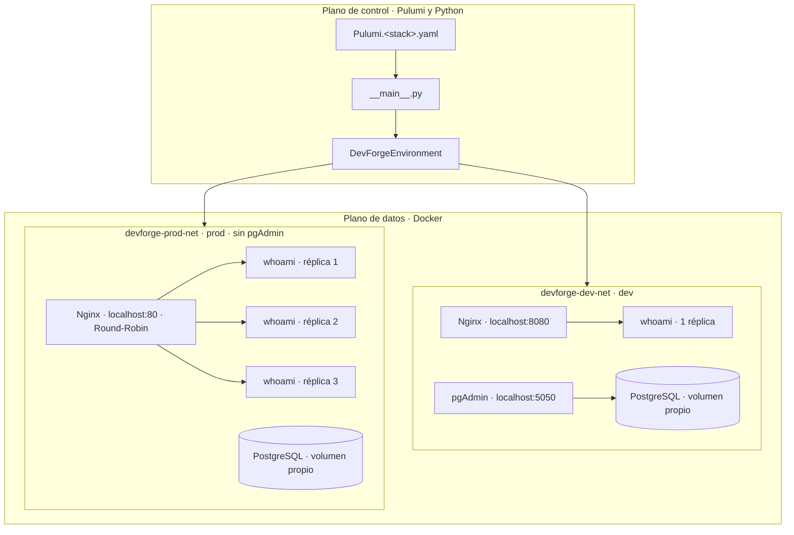

# DevForge Cloud

DevForge Cloud aprovisiona entornos de desarrollo y producción en Docker local mediante infraestructura como código (IaC) declarativa con Pulumi y Python. Los scripts PowerShell de DevForge v1.0 instalaban herramientas con `winget` y carecían de un estado que permitiera retomar una ejecución parcial o detectar desviaciones. DevForge Cloud declara la topología deseada, registra los recursos aprovisionados y usa ese estado para aplicar cambios incrementales. El MVP incluye los stacks `dev` y `prod`.

## Patrones Arquitectónicos Cloud y Atributos de Calidad

- **Deployment Stamps (principal).** `DevForgeEnvironment(pulumi.ComponentResource)` agrupa la red privada, el volumen de PostgreSQL, las réplicas y el balanceador. Cada stack instancia el mismo componente con nombres y recursos propios. [Deployment Stamps](https://learn.microsoft.com/en-us/azure/architecture/patterns/deployment-stamp).
- **External Configuration Store (complementario).** `Pulumi.<stack>.yaml` guarda el dimensionamiento y las opciones de cada entorno fuera del código Python. El cargador valida el número de réplicas, los puertos y la habilitación de pgAdmin al construir el contrato inmutable `EnvironmentConfig`. [External Configuration Store](https://learn.microsoft.com/en-us/azure/architecture/patterns/edge-workload-configuration).
- **Gateway Routing (complementario).** Cada sello usa `nginx:1.27-alpine` como proxy inverso y punto de entrada para el tráfico de aplicación. Nginx enruta las solicitudes a las réplicas dentro de la red bridge privada y las distribuye en Round-Robin en `prod`. [Gateway Routing](https://learn.microsoft.com/en-us/azure/architecture/patterns/gateway-routing).

| Atributo de calidad | Prioridad | Aplicación |
| --- | --- | --- |
| Mantenibilidad y reutilización | Alta | Un componente compartido y un contrato inmutable permiten ajustar cada stack mediante configuración. |
| Disponibilidad y resiliencia | Alta | Nginx reparte las solicitudes entre tres réplicas en `prod`. El operador inicia la reconciliación (*Self-Healing*) con Pulumi. E3 propone *Pilot Light*, respaldo y restauración, y conmutación automatizada. |
| Seguridad por diseño | Media-alta | PostgreSQL usa `ports=[]` y mantiene el puerto `5432` dentro de la red del stack. `prod` omite pgAdmin. |
| Portabilidad y costo | Media | Docker local permite reproducir la topología en el laboratorio sin una cuenta de nube. El contrato de configuración se comparte entre entornos. |

## Arquitectura y Topología

El plano de control lee la configuración del stack seleccionado y declara los recursos. El plano de datos aloja los sellos de Docker, que pueden coexistir por sus redes, nombres y puertos diferenciados.



Nginx publica el puerto de servicio de cada stack y pgAdmin publica su puerto de administración en `dev`. Las réplicas y PostgreSQL se mantienen en la red privada correspondiente.

## Estructura del Repositorio y Estado de ADRs

```text
.
├── __main__.py                    # Carga la configuración, crea el sello y exporta sus outputs
├── Pulumi.yaml                    # Proyecto Pulumi con runtime Python y entorno virtual venv
├── Pulumi.dev.yaml                # Configuración de desarrollo
├── Pulumi.prod.yaml               # Configuración de producción
├── requirements.txt              # Dependencias de IaC y pruebas
├── components/
│   ├── config_loader.py           # Contrato EnvironmentConfig y validaciones
│   ├── network_factory.py         # Red bridge aislada por stack
│   ├── environment_stack.py      # Componente DevForgeEnvironment
│   └── load_balancer_conf.py     # Upstreams y configuración de Nginx
├── tests/                        # Pruebas de configuración y del grafo de recursos
└── docs/
    ├── adrs/                     # Decisiones de arquitectura
    ├── specs/context-master.md   # Diseño y hoja de ruta
    └── walkthroughs/             # Explicaciones de los ADR implementados
```

| ADR | Etapa | Estado | Entrega |
| --- | --- | --- | --- |
| [ADR-001](docs/adrs/ADR-001.md) | E1 | Implementado | Proyecto IaC con Pulumi, Python y entorno virtual. |
| [ADR-002](docs/adrs/ADR-002.md) | E1 | Implementado | Stacks `dev` y `prod` con configuración validada y redes Docker aisladas. |
| [ADR-003](docs/adrs/ADR-003.md) | E2 | Implementado | Componente reutilizable con PostgreSQL persistente, pgAdmin condicional y balanceo Nginx. |
| [ADR-004](docs/adrs/ADR-004.md) | E3 | Proposed | Estrategia de Recuperación ante Desastres mediante Pilot Light, Backup y Failover con Deployment Stamps |

La propuesta de E3 mantiene PostgreSQL activo en `dr` con cero réplicas de cómputo en espera y fija un objetivo de tiempo de recuperación (RTO) inferior a 10 segundos. El [contexto maestro](docs/specs/context-master.md#6-hoja-de-ruta-y-grafo-de-adrs) recoge esta propuesta.

## Requisitos Previos e Instalación Rápida

- Python 3.10 o superior y Windows PowerShell 5.1 o posterior. En PowerShell 5.1, asignar `""` elimina la variable de entorno y Pulumi solicita la passphrase de forma interactiva. La demo usa una passphrase fija de laboratorio con `$env:PULUMI_CONFIG_PASSPHRASE="devforge-local-passphrase"`. [Variables de entorno en PowerShell 5.1](https://learn.microsoft.com/en-us/powershell/module/microsoft.powershell.core/about/about_environment_variables?view=powershell-5.1).
- Docker Desktop con el motor en ejecución. Comprueba la conexión con `docker info`.
- Pulumi CLI disponible en `PATH`. Comprueba la instalación con `pulumi version`. [Instalación de Pulumi](https://www.pulumi.com/docs/install/).
- Puertos `8080`, `5050` y `80` libres. El primer despliegue requiere acceso al registro de imágenes y a la descarga del plugin Docker de Pulumi.

Ejecuta los comandos desde la raíz del repositorio en Windows PowerShell.

```powershell
python -m venv venv
venv\Scripts\python -m pip install -r requirements.txt
venv\Scripts\python -m pytest
venv\Scripts\python -m compileall -q .
```

El resultado esperado es `25 passed` y código de salida `0` en ambas verificaciones. Las pruebas usan mocks de Pulumi para validar la configuración y el grafo de recursos. Ejecútalas antes de la demo. Al inicializar un stack, Pulumi puede reescribir su YAML y convertir valores que las pruebas comprueban como enteros o booleanos.

## Guion Paso a Paso para Demostración en Vivo (Exposición)

### Fase 1 — Inicialización del Backend de Estado Local

Usa una terminal de PowerShell en la raíz del repositorio. Pulumi guardará el estado en `~/.pulumi`. La passphrase fija y no vacía evita el prompt interactivo al crear los stacks de laboratorio. Para reutilizar un stack ya inicializado, usa la passphrase con la que se creó. [Backend local de Pulumi](https://www.pulumi.com/docs/iac/cli/commands/pulumi_login/).

```powershell
pulumi login --local
$env:PULUMI_CONFIG_PASSPHRASE="devforge-local-passphrase"
```

### Fase 2 — Despliegue del Stamp de Desarrollo (dev)

Presenta la previsualización del grafo antes de aplicar los cambios. La opción `--create` crea el stack si aún no existe. [Selección de stacks](https://www.pulumi.com/docs/iac/cli/commands/pulumi_stack_select/).

```powershell
pulumi stack select dev --create
pulumi preview
pulumi up --yes
pulumi stack output service_url
pulumi stack output pgadmin_url
curl.exe -s http://localhost:8080
docker ps --filter "name=devforge-dev"
docker port devforge-dev-db
```

Los outputs esperados son `http://localhost:8080` y `http://localhost:5050`. La respuesta HTTP identifica a `devforge-dev-app-1`. En `docker ps`, Nginx y pgAdmin muestran asignaciones de puerto al host. `docker port devforge-dev-db` devuelve una salida vacía.

### Fase 3 — Despliegue del Stamp de Producción (prod) y Balanceo Round-Robin

Despliega `prod` mientras `dev` sigue activo. Muestra las tres réplicas y sus destinos en el balanceador.

```powershell
pulumi stack select prod --create
pulumi up --yes
pulumi stack output upstream_hosts
docker ps --filter "name=devforge-prod"
docker port devforge-prod-db
1..6 | ForEach-Object { curl.exe -s http://localhost:80 | Select-String "Hostname" }
```

El listado de `prod` muestra Nginx, PostgreSQL y las tres réplicas. PgAdmin se omite y `docker port devforge-prod-db` devuelve una salida vacía, lo que comprueba que el stack mantiene `5432` cerrado al host. En las seis respuestas HTTP deben aparecer los tres hostnames de las réplicas en dos ciclos de Round-Robin.

### Fase 4 — Demostración de Resiliencia y Autorreparación (Drift Detection & Self-Healing)

Con `prod` seleccionado, anota el ID de la réplica y elimínala fuera de Pulumi. `refresh` registra la ausencia en el estado. `up` compara ese estado con la declaración y vuelve a crear la réplica en segundos. [Pulumi refresh](https://www.pulumi.com/docs/iac/cli/commands/pulumi_refresh/) y [Pulumi up](https://www.pulumi.com/docs/iac/cli/commands/pulumi_up/).

```powershell
docker ps --filter "name=devforge-prod-app-2"
docker rm -f devforge-prod-app-2
pulumi refresh --yes
pulumi up --yes
docker restart devforge-prod-lb
docker ps --filter "name=devforge-prod-app-2"
1..6 | ForEach-Object { curl.exe -s http://localhost:80 | Select-String "Hostname" }
```

Comprueba que la réplica aparece con un ID nuevo y que el balanceador vuelve a servir las tres réplicas. El reinicio hace que Nginx resuelva de nuevo los nombres de los upstreams y use la IP actual de la réplica. [Configuración de upstreams en Nginx](https://nginx.org/en/docs/http/ngx_http_upstream_module.html).

### Fase 5 — Limpieza de Entornos (Teardown)

Conserva cualquier edición propia de los YAML antes de ejecutar la limpieza. `pulumi destroy` elimina los recursos de ambos stacks, incluidos los volúmenes y sus datos. `pulumi stack rm` retira los stacks del backend local y elimina sus archivos de configuración. `git restore` recupera los YAML versionados, sin el `encryptionsalt` añadido por Pulumi. [Pulumi destroy](https://www.pulumi.com/docs/iac/cli/commands/pulumi_destroy/) y [Pulumi stack rm](https://www.pulumi.com/docs/iac/cli/commands/pulumi_stack_rm/).

```powershell
pulumi destroy --yes --stack prod
pulumi destroy --yes --stack dev
pulumi stack rm prod --yes
pulumi stack rm dev --yes
git restore Pulumi.dev.yaml Pulumi.prod.yaml
git status
```
