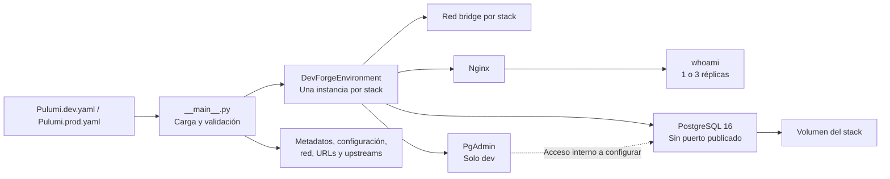

# DevForge Cloud

**Una definición de infraestructura para dos entornos locales, con cambios planificados y estado gestionado.**

DevForge Cloud aprovisiona entornos `dev` y `prod` sobre Docker mediante Pulumi y Python. Sustituye la preparación imperativa de máquinas por un grafo declarativo reutilizable: red, PostgreSQL con volumen, réplicas HTTP y balanceador Nginx. Está dirigido a desarrolladores e ingenieros DevOps que necesitan entornos consistentes y una forma verificable de explicar sus cambios.

El MVP permite demostrar tres capacidades: reutilización del mismo componente entre entornos, separación de recursos y puertos, y reconciliación de recursos eliminados fuera de Pulumi. La infraestructura se ejecuta en el equipo del presentador, sin aprovisionar servicios de nube pública. `prod` identifica la configuración del laboratorio; ambos stacks comparten el mismo host.

## Valor y estado de entrega

| Prioridad | Capacidad presente | Evidencia disponible |
| --- | --- | --- |
| Mantenibilidad | `DevForgeEnvironment` agrupa la topología; `EnvironmentConfig` es tipado e inmutable. | Jerarquía y contratos verificados con mocks. |
| Seguridad por diseño | Red bridge por stack; PostgreSQL y backends sin puertos publicados; PgAdmin bloqueado en `prod`. | Validaciones de configuración y propiedades del grafo en pruebas. |
| Resiliencia | Tres réplicas en `prod`, upstream Nginx y recursos con estado Pulumi. | Configuración cubierta por pruebas; reparto HTTP y recuperación requieren ensayo operativo. |
| Trazabilidad | Decisiones y registros por ADR. | ADR-001 a ADR-003 implementados; ADR-004 aceptado y pendiente de implementación. |

**Validación del repositorio al 22-10-2026:** Python `3.14.2`, `25 passed` con `venv\Scripts\python -m pytest` y código `0` con `venv\Scripts\python -m compileall -q .`. Estas comprobaciones no requieren Docker. En esta revisión Pulumi CLI no estaba disponible en `PATH` y el daemon de Docker no era accesible; el guion siguiente no se ha ensayado de extremo a extremo. El objetivo arquitectónico de despliegue inferior a 15 segundos sigue pendiente de medición.

## Arquitectura y configuración



Todos los contenedores de una instancia se conectan a su red. `whoami` es un servicio de demostración HTTP: recibe `DB_HOST`, pero no implementa operaciones de negocio ni consultas a PostgreSQL. El volumen respalda el directorio de datos de PostgreSQL; no constituye una estrategia de backups.

| Parámetro | `dev` | `prod` |
| --- | --- | --- |
| Réplicas HTTP | 1 | 3 |
| Servicio | `http://localhost:8080` | `http://localhost:80` |
| PgAdmin | `http://localhost:5050` | No se crea |
| Red | `devforge-dev-net` | `devforge-prod-net` |
| Volumen PostgreSQL | `devforge-dev-pgdata` | `devforge-prod-pgdata` |
| Base / usuario de laboratorio | `devforgedb` / `devforge_user` | `devforgedb` / `devforge_user` |

Los outputs del stack son `metadata`, `environment_config`, `network_name`, `service_url`, `pgadmin_url` y `upstream_hosts`. En `prod`, `pgadmin_url` se declara con valor `None`; la evidencia de exclusión es la ausencia del contenedor.

| Archivo o directorio | Responsabilidad |
| --- | --- |
| [__main__.py](__main__.py) | Lee el contrato, instancia el componente y exporta resultados. |
| [components/](components/) | Configuración, red, topología y generación de Nginx en memoria. |
| [Pulumi.yaml](Pulumi.yaml) y [requirements.txt](requirements.txt) | Runtime Python con `venv` y dependencias autorizadas. |
| [tests/](tests/) | Contratos y grafo simulado mediante mocks de Pulumi. |
| [docs/adrs/](docs/adrs/) | Decisiones aprobadas y especificaciones de implementación. |
| [Contexto maestro](docs/specs/context-master.md#6-hoja-de-ruta-y-grafo-de-adrs) | Hoja de ruta y seguimiento del avance. |

## Preparación antes de presentar

Usa Windows con PowerShell, Python `>=3.10`, Pulumi CLI instalado en `PATH` y Docker Desktop iniciado en modo de contenedores Linux. Reserva los puertos `80`, `8080` y `5050`. Ejecuta los bloques desde la raíz del repositorio, en orden, y detente ante cualquier comando fallido. Descarga dependencias, imágenes y el plugin del proveedor antes de la exposición.

### 1. Comprobar herramientas y preparar Python

```powershell
Set-Location C:\dev\DevForgeCloud
python --version
Get-Command pulumi, docker
pulumi version
docker version
```

`docker version` debe mostrar tanto cliente como servidor. Si falta el servidor, inicia Docker Desktop y repite la comprobación. Adapta la ruta si tu copia está en otra ubicación.

Si aún no existe `venv`, créalo con `python -m venv venv`. Después:

```powershell
venv\Scripts\python --version
venv\Scripts\python -m pip install -r requirements.txt
venv\Scripts\python -m pytest
venv\Scripts\python -m compileall -q .
```

Resultado esperado en esta versión: `25 passed` y compilación sin errores. No necesitas activar el entorno virtual.

### 2. Descargar las imágenes declaradas

```powershell
docker pull postgres:16-alpine
docker pull dpage/pgadmin4:latest
docker pull traefik/whoami:v1.10
docker pull nginx:1.27-alpine
```

Las etiquetas coinciden con el componente actual. Las descargas iniciales y el arranque de Docker no forman parte de una medición de despliegue con caché. Ver sintaxis de [Docker pull](https://docs.docker.com/reference/cli/docker/image/pull/).

### 3. Elegir el backend local y registrar los stacks

Para una copia nueva, este bloque sitúa el backend en la raíz del proyecto; Pulumi almacena su estado en el subdirectorio `.pulumi/`, excluido de Git. Si ya tienes despliegues, utiliza su backend original: cambiar de backend no importa recursos existentes. La forma `file://` y la diferencia con `--local` están documentadas en [Pulumi login](https://www.pulumi.com/docs/iac/cli/commands/pulumi_login/).

```powershell
$backendPath = (Get-Location).Path.Replace('\', '/')
pulumi login "file:///$backendPath"
pulumi stack select dev --create --secrets-provider passphrase
pulumi stack select prod --create --secrets-provider passphrase
pulumi preview --stack dev
pulumi preview --stack prod
```

[Stack select](https://www.pulumi.com/docs/iac/cli/commands/pulumi_stack_select/) selecciona cada stack y lo crea si falta. Conserva los parámetros de los YAML existentes y atiende los prompts de passphrase sin proyectarla ni escribirla en comandos. La inicialización puede añadir metadatos de cifrado a `Pulumi.<stack>.yaml`; conserva esos archivos y guarda la passphrase por separado, fuera del repositorio, para seguir operando el estado. Los previews permiten resolver la descarga inicial del plugin y comprobar el grafo antes de presentar.

La passphrase cifra secretos del estado; no cambia la contraseña de PostgreSQL. El orquestador actual utiliza una contraseña predeterminada predecible, envuelta en `Output.secret`, para PostgreSQL y PgAdmin. No lee una clave de configuración para sustituirla: añadir un secreto al stack por CLI no lo conecta automáticamente al componente. Este límite debe resolverse en una tarea de implementación antes de usar datos reales o exponer el sistema fuera del laboratorio.

## Demo en vivo

Ejecuta los actos en la misma consola, después de la preparación. Cada acto incluye el mensaje para el público y la evidencia que debes mostrar. Si ensayaste previamente, el despliegue inicial puede mostrar recursos sin cambios en lugar de nuevas creaciones.

### 1. Mostrar la decisión: dos entornos, una definición

**Guion:** «Los entornos se diferencian por configuración. El mismo componente construye toda la topología y Pulumi mantiene un estado independiente por stack».

```powershell
Get-Content Pulumi.dev.yaml
Get-Content Pulumi.prod.yaml
```

**Evidencia:** una réplica y PgAdmin en `dev`; tres réplicas y PgAdmin deshabilitado en `prod`; puertos de entrada distintos. Evita proyectar archivos de configuración si posteriormente incorporan información sensible.

### 2. Planificar y desplegar desarrollo

**Guion:** «Revisamos el plan antes de aplicar los cambios; los recursos aparecen agrupados bajo el componente de entorno».

```powershell
pulumi preview --stack dev --diff
pulumi up --stack dev
pulumi stack output --stack dev
$devUrl = pulumi stack output service_url --stack dev
Invoke-WebRequest -Uri $devUrl -UseBasicParsing -TimeoutSec 10 | Select-Object StatusCode, Content
```

Revisa el plan y confirma `yes` cuando corresponda. [Preview](https://www.pulumi.com/docs/iac/cli/commands/pulumi_preview/) muestra los cambios y [up](https://www.pulumi.com/docs/iac/cli/commands/pulumi_up/) los aplica. [Stack output](https://www.pulumi.com/docs/iac/cli/commands/pulumi_stack_output/) permite obtener la URL exportada.

**Evidencia:** respuesta HTTP `200` de `whoami`, servicio en `8080` y URL de PgAdmin en `5050`. Docker debe mostrar cuatro contenedores del stack: DB, PgAdmin, aplicación y balanceador. La creación de un contenedor no acredita por sí sola que su servicio esté listo; comprueba la respuesta antes de avanzar.

### 3. Desplegar producción local y mostrar el reparto HTTP

**Guion:** «El segundo stack reutiliza el componente y amplía la capacidad a tres réplicas, manteniendo desarrollo activo».

```powershell
pulumi preview --stack prod --diff
pulumi up --stack prod
pulumi stack output upstream_hosts --stack prod
docker ps --filter "name=devforge-" --format "table {{.Names}}\t{{.Status}}\t{{.Ports}}"
$prodUrl = pulumi stack output service_url --stack prod
1..9 | ForEach-Object {
    (Invoke-WebRequest -Uri $prodUrl -UseBasicParsing -TimeoutSec 10).Content -split '\r?\n' |
        Select-String -Pattern '^(Hostname|Name):'
}
```

**Evidencia:** cinco contenedores de `prod` y cuatro de `dev`, tres destinos en `upstream_hosts` e identidades de distintas réplicas en las respuestas. El hostname puede ser un identificador de contenedor. Nginx utiliza [Round-Robin por defecto](https://nginx.org/en/docs/http/ngx_http_upstream_module.html); la muestra sirve para observar varias réplicas, sin exigir una secuencia textual exacta.

### 4. Verificar aislamiento y persistencia declarada

**Guion:** «La base de datos queda en la red del stack; solo publicamos las entradas HTTP previstas. Producción no incorpora la herramienta administrativa».

```powershell
docker network inspect devforge-dev-net devforge-prod-net --format '{{.Name}}: {{range .Containers}}{{.Name}} {{end}}'
docker inspect devforge-dev-db devforge-prod-db --format '{{.Name}}: {{json .NetworkSettings.Ports}}'
docker inspect devforge-prod-db --format '{{json .Mounts}}'
docker ps -a --filter "name=devforge-prod-pgadmin" --format '{{.Names}}'
```

**Evidencia:** miembros con el prefijo de cada stack en su propia red; PostgreSQL sin asignación de puerto al host (puede aparecer `5432/tcp` con valor `null`); volumen `devforge-prod-pgdata` montado en `/var/lib/postgresql/data`; ninguna salida para PgAdmin de `prod`. Esta inspección acredita el montaje, no una prueba de restauración de datos. Se consultan propiedades concretas para evitar mostrar variables de entorno con contraseñas; ver [Docker inspect](https://docs.docker.com/reference/cli/docker/container/inspect/).

### 5. Provocar drift y reconciliar el recurso

**Guion:** «Eliminaremos una réplica HTTP fuera de Pulumi. Después consultaremos Docker para detectar la diferencia y pediremos a Pulumi que reconstruya el recurso».

El siguiente comando elimina deliberadamente solo la réplica de laboratorio indicada. Antes de ejecutarlo, confirma visualmente el nombre; no elimina la DB ni su volumen. La opción `-f` permite [eliminar un contenedor en ejecución](https://docs.docker.com/reference/cli/docker/container/rm/).

```powershell
$replicaBefore = docker inspect devforge-prod-app-1 --format '{{.Id}}'
$databaseBefore = docker inspect devforge-prod-db --format '{{.Id}}'
docker rm -f devforge-prod-app-1
docker ps --filter "name=devforge-prod-app-" --format '{{.Names}}'
pulumi preview --stack prod --refresh --diff
pulumi up --stack prod --refresh
$replicaAfter = docker inspect devforge-prod-app-1 --format '{{.Id}}'
$databaseAfter = docker inspect devforge-prod-db --format '{{.Id}}'
[pscustomobject]@{
    ReplicaRecreada = $replicaBefore -ne $replicaAfter
    BaseConservada = $databaseBefore -eq $databaseAfter
}
Invoke-WebRequest -Uri $devUrl -UseBasicParsing -TimeoutSec 10 | Select-Object StatusCode
Invoke-WebRequest -Uri $prodUrl -UseBasicParsing -TimeoutSec 10 | Select-Object StatusCode, Content
```

**Evidencia:** dos réplicas antes de la reconciliación, plan de creación del recurso ausente, tres réplicas después y ambos indicadores en `True`. Revisa el plan: si propone reemplazar la base o el volumen, detén el acto e investiga. `--refresh` consulta los recursos reales antes de comparar; un preview sin refresh no basta para demostrar drift externo. La recuperación la invoca el operador; no existe un bucle continuo de autorreparación en el proyecto.

Si la réplica recreada cambia de IP, el proxy puede conservar su resolución anterior: la configuración actual no incluye `resolver` ni `resolve`. Es una limitación operativa que debe comprobarse durante el ensayo. Si el reparto no se recupera, recarga Nginx y repite las peticiones del acto 3:

```powershell
docker exec devforge-prod-lb nginx -s reload
```

Esta recarga es una intervención del operador y debe explicarse como tal; no acredita recuperación automática completa. Véanse [resolución de upstreams](https://nginx.org/en/docs/http/ngx_http_upstream_module.html#resolve) y [recarga de Nginx](https://nginx.org/en/docs/beginners_guide.html). Tampoco se garantiza ausencia de errores HTTP durante la caída: hay un solo proxy, una sola DB y un único host.

### 6. Cerrar con idempotencia

**Guion:** «Con el estado reconciliado, el mismo programa debe proponer cero cambios para los dos entornos».

```powershell
pulumi preview --stack dev --refresh --expect-no-changes
pulumi preview --stack prod --refresh --expect-no-changes
```

**Evidencia:** ambos previews terminan con código `0`, sin cambios propuestos. La opción `--expect-no-changes` convierte una diferencia inesperada en un error verificable. Concluye mostrando qué está implementado y el siguiente hito aprobado: gobernanza, traducción de contratos cloud e integración continua.

## Retirada del laboratorio

Opcional, después de presentar y solo cuando puedas perder los datos de la demo. Estos comandos solicitan confirmación y eliminan los recursos gestionados, incluidos los volúmenes de PostgreSQL; guarda antes cualquier dato que necesites. [Pulumi destroy](https://www.pulumi.com/docs/iac/cli/commands/pulumi_destroy/) conserva el stack para reutilizarlo posteriormente.

```powershell
pulumi destroy --stack prod
pulumi destroy --stack dev
```

Conserva el backend y las passphrases hasta terminar todas las operaciones. No borres `.pulumi/` para intentar corregir recursos que aún existen.

## Próximo hito y decisiones

| ADR | Decisión | Situación |
| --- | --- | --- |
| [ADR-001](docs/adrs/ADR-001.md) | Pulumi y Python. | Aceptado e implementado. |
| [ADR-002](docs/adrs/ADR-002.md) | Docker local, stacks y configuración aislada. | Aceptado e implementado. |
| [ADR-003](docs/adrs/ADR-003.md) | Componente de entorno y balanceo Nginx. | Aceptado e implementado; validación operativa pendiente. |
| [ADR-004](docs/adrs/ADR-004.md) | Gobernanza, portabilidad y CI. | Aceptado; implementación pendiente. |

La Parte B de ADR-004 prevé validadores puros de seguridad, un contrato traducible a Azure/AWS y un workflow de GitHub Actions. Todavía no existe esa implementación ni una integración activa de CrossGuard; la traducción prevista tampoco aprovisiona recursos cloud reales. Las explicaciones del MVP están disponibles en los walkthroughs de [ADR-001](docs/walkthroughs/ADR-001.md), [ADR-002](docs/walkthroughs/ADR-002.md) y [ADR-003](docs/walkthroughs/ADR-003.md).
