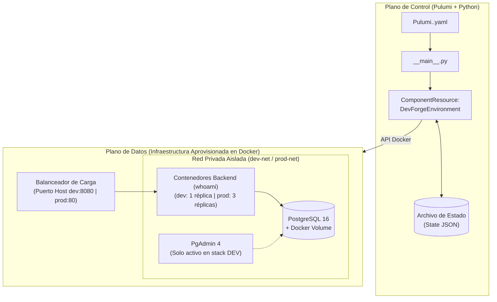
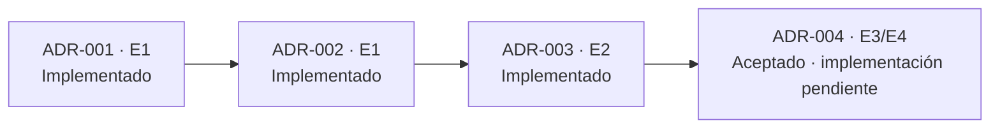

# DevForge Cloud — Contexto Maestro de Arquitectura (SSOT de Diseño)

> **Alcance de este documento:** Este archivo es la fuente de verdad de diseño macro. Se utiliza **exclusivamente** durante sesiones de descubrimiento y redacción de especificaciones (`docs/adrs/ADR-00X.md`).
> **Regla de aislamiento:** Los agentes en rol de *Implementación* o *Revisión* NO leen este documento; se rigen únicamente por `AGENTS.md` y la Parte B del ADR activo. Toda regla de negocio o contrato aquí descrito que aplique a una tarea debe traducirse explícitamente en las secciones 7, 8 y 9 del ADR correspondiente.

---

## 1. Problema y Propósito Arquitectónico
<!-- Alimenta la Sección 1 (Contexto) de la Parte A de los ADRs -->

- **Problema y limitaciones a resolver:** *DevForge v1.0* utilizaba scripts imperativos en PowerShell (`winget`), presentando ausencia de gestión de estado e idempotencia ante fallos parciales, contaminación del sistema anfitrión (*Configuration Drift* por conflictos de puertos y versiones en el SO local) y nula portabilidad hacia entornos de producción o nubes públicas.
- **Solución arquitectónica adoptada:** Evolución hacia Infraestructura como Código (IaC) declarativa con **Pulumi y Python**. Aprovisiona entornos completos, aislados y reproducibles (*Development* y *Production*) mediante una única definición orientada a objetos (`ComponentResource`), garantizando gestión de estado transaccional, detección de desviaciones (*drift*) y autorreparación.
- **Actores / Consumidores:** Desarrolladores de software e ingenieros DevOps que requieren levantar y gestionar entornos estandarizados con un solo comando (`pulumi up`), así como usuarios/clientes HTTP que consumen los servicios expuestos a través del balanceador de carga.

---

## 2. Atributos de Calidad y Restricciones del Proyecto
<!-- Alimenta directamente la Sección 3 (Criterios de elección) de la Parte A de los ADRs -->

### 2.1 Jerarquía de Atributos de Calidad (Trade-offs)
1. **Mantenibilidad y Reutilización (Prioridad Alta):** Encapsulamiento de la topología completa (red, persistencia, cómputo y balanceo) en un único módulo reutilizable (`ComponentResource`), parametrizado por archivos de configuración sin duplicar código entre entornos.
2. **Disponibilidad y Resiliencia (Prioridad Alta):** Capacidad de escalar horizontalmente las réplicas de aplicación detrás de un balanceador de carga en `prod`, sumado a la reconciliación automática del estado deseado (*self-healing*) si un contenedor falla o es eliminado manualmente.
3. **Seguridad por Diseño (Prioridad Media-Alta):** Aislamiento a nivel de red privada (la capa de datos no es accesible desde el exterior) y reducción de superficie de ataque por entorno (PgAdmin se despliega en `dev` pero se omite por configuración en `prod`).
4. **Portabilidad y Costo (Prioridad Media):** Ejecución 100% gratuita y determinista sobre Docker Provider local para el MVP, manteniendo el diseño desacoplado para migrar hacia nube pública (Azure/AWS) en hitos posteriores.

### 2.2 Restricciones Duras (Laboratorio / Entorno / Negocio)
- **Tiempo / Rendimiento objetivo:** Plazo de 24 horas para el Hito 1 (Demo MVP); la implementación debe estar libre de compilaciones pesadas y desplegarse en menos de 15 segundos.
- **Presupuesto y fricción:** Costo $0 USD y cero fricción bancaria (sin uso de tarjetas de crédito ni dependencia de activación de cuentas cloud en el Hito 1).
- **Entorno anfitrión base:** Windows 11 con Docker Desktop y Python 3 (`>=3.10`) instalados.

---

## 3. Arquitectura Macro y Topología del Sistema
<!-- Define los límites espaciales para que los ADRs no rompan el diseño global -->

### 3.1 Stack Tecnológico Base
- **Core / Motor:** Pulumi CLI (grafo DAG, estado transaccional e idempotencia) + Python 3.x (`pulumi`, `pulumi_docker`).
- **Proveedores / Servicios:** Docker Engine (local), Balanceador de Carga (`nginx:alpine` o `traefik`), Backend Dummy (`traefik/whoami`), Capa de Datos (`postgres:16-alpine` con volúmenes Docker) y Gestión DB condicional (`dpage/pgadmin4`).

### 3.2 Diagrama de Topología y Flujo de Interacción

---

## 4. Contratos de Componentes y Reglas de Dominio

### 4.1 Reglas de Negocio / Dominio Inviolables

* **Seguridad condicional de herramientas de gestión:** PgAdmin (`dpage/pgadmin4`) solo se instancia si el flag `enable_pgadmin == True` (activo en `dev`, omitido/bloqueado en `prod`).

* **Aislamiento estricto de persistencia:** El contenedor PostgreSQL (`postgres:16-alpine`) se conecta únicamente a la red privada del stack y nunca expone el puerto `5432` al sistema anfitrión.

* **Prevención de colisiones multi-entorno:** Todo recurso físico y lógico debe incluir el nombre del stack como prefijo (`devforge-{stack}-{recurso}`) y utilizar puertos de host diferenciados por entorno (`dev:8080`, `prod:80`) para permitir la coexistencia simultánea en el mismo daemon de Docker.

* **Pureza declarativa del grafo:** Prohibido ejecutar efectos secundarios imperativos fuera del grafo de Pulumi durante la evaluación ni almacenar credenciales en texto plano en el repositorio.

### 4.2 Componentes Clave y Contratos (Inputs / Outputs)

1. **Configuración por Stack (`Pulumi.dev.yaml` / `Pulumi.prod.yaml`):**
* *Variables / Contrato:* `[replicas, puertos expuestos, límites de recursos, enable_pgadmin, secretos cifrados]`.

2. **Orquestador (`__main__.py`):**
* *Responsabilidad:* Punto de entrada que lee la configuración activa del stack (`pulumi.Config`), instancia el componente de infraestructura y exporta los *Outputs* (`pulumi.export` con metadatos, URLs de acceso y cadenas de conexión).

3. **Abstracción de Infraestructura (`components/environment_stack.py`):**
* *Firma / Clase:* `DevForgeEnvironment(pulumi.ComponentResource)`.

* *Recursos gestionados:* Red virtual puente aislada (`docker.Network`), volumen persistente (`docker.Volume`), contenedor PostgreSQL, instancia condicional de PgAdmin, $N$ réplicas del contenedor de aplicación (`traefik/whoami`) y balanceador de carga conectado a las réplicas.

4. **Backend de Estado (`.pulumi/` local):**
* *Responsabilidad:* Almacena el archivo JSON transaccional con el estado real de la infraestructura para calcular diferencias (`pulumi preview`) y aplicar cambios incrementales (`pulumi up`).

---

## 5. Alcance por Etapas (Control de Scope para Parte B)

* **Etapa Actual (`E1` - `E2` MVP):** Inicialización del proyecto Pulumi con Python y entorno virtual (`ADR-001`), configuración de stacks aislados `dev`/`prod` sobre proveedor Docker local (`ADR-002`), e implementación del componente `DevForgeEnvironment` con persistencia PostgreSQL, PgAdmin condicional, $N$ réplicas balanceadas y demostración de *Drift Detection / Self-Healing* (`ADR-003`).

* **Fuera de Alcance de la Etapa Actual (`E3+`):** Validación estática de gobernanza y seguridad con *Policy as Code* (Pulumi CrossGuard), migración del proveedor de infraestructura hacia nube pública (Azure for Students / AWS) y automatización de pipelines GitOps CI/CD en GitHub Actions (`ADR-004`).

---

## 6. Hoja de Ruta y Grafo de ADRs

**Corte de seguimiento: 22-10-2026.** El estado de aprobación se toma de cada ADR; el avance se contrasta con sus registros y los archivos presentes en el repositorio. Una decisión aceptada no implica que su implementación esté terminada.

| ID | Etapa | Decisión | Estado del ADR | Depende de | Avance y evidencia de implementación |
| --- | --- | --- | --- | --- | --- |
| [ADR-001](../adrs/ADR-001.md) | `E1` | Pulumi con Python como motor y lenguaje de IaC | `Accepted` (22-10-2026) | — | Implementado: manifiesto Python con `venv`, dependencias, metadatos del proyecto y pruebas de bootstrap. Registro: 3 pasos documentados. |
| [ADR-002](../adrs/ADR-002.md) | `E1` | Docker local y aislamiento mediante Pulumi Stacks | `Accepted` (22-10-2026) | ADR-001 | Implementado: YAML de `dev`/`prod`, contrato inmutable `EnvironmentConfig`, validaciones y redes bridge `devforge-dev-net` / `devforge-prod-net`. Registro: 4 pasos documentados. |
| [ADR-003](../adrs/ADR-003.md) | `E2` | Modularización con `ComponentResource` y balanceo de carga | `Accepted` (22-10-2026) | ADR-002 | Implementado: `DevForgeEnvironment`, PostgreSQL con volumen, PgAdmin condicional, réplicas `whoami`, Nginx y outputs del orquestador. Registro: 4 pasos documentados; grafo cubierto con mocks. |
| [ADR-004](../adrs/ADR-004.md) | `E3` / `E4` | Gobernanza, portabilidad cloud y automatización GitOps | `Accepted` (22-10-2026) | ADR-003 | Pendiente: el Registro no contiene avances y aún no existen `policies/`, `components/cloud_portability.py`, `.github/workflows/iac-ci.yml` ni `tests/test_governance_and_portability.py`. La Parte B prevé validadores puros, traducción de contratos a Azure/AWS y CI; excluye despliegues cloud reales en las pruebas. |

**Evidencia del corte:** `venv\Scripts\python -m pytest` → `25 passed`, código `0`; `venv\Scripts\python -m compileall -q .` → código `0`; runtime Python `3.14.2` compatible con el mínimo `>=3.10`. Las pruebas verifican configuración y grafo simulado. Balanceo HTTP, recuperación de recursos y objetivo de despliegue inferior a 15 segundos requieren ensayo con Pulumi CLI y Docker operativo; no se consideran demostrados por los mocks.

**Próximo hito:** ejecutar la Parte B de ADR-004 en su propia tarea y ensayar la [demo de presentación](../../README.md#demo-en-vivo) del MVP local. La recuperación se plantea como reconciliación invocada por el operador; el código actual no incorpora un controlador continuo. El orquestador utiliza la contraseña predeterminada predecible del componente, aunque esté marcada como output secreto: sigue siendo una limitación del laboratorio.

---

## 7. Registro de Evolución del Contexto Maestro

* **22-10-2026:** Creación de la línea base arquitectónica a partir del Informe Ejecutivo y aprobación de `ADR-001`.
* **22-10-2026:** Actualización de la sección 6 por autorización del Responsable: sincronización de los cuatro ADRs en estado `Accepted`, distinción entre ADR-001 a ADR-003 implementados y ADR-004 pendiente, y grafo de dependencias. Se precisa el alcance de portabilidad previsto por la Parte B de ADR-004.
* **22-10-2026:** Incorporación de la evidencia de 25 pruebas y compilación correcta; registro de los límites de validación operativa, reconciliación y contraseña predeterminada. Se enlaza el README ejecutivo con el guion de demo. Las secciones 1 a 5 se conservan sin modificaciones.
