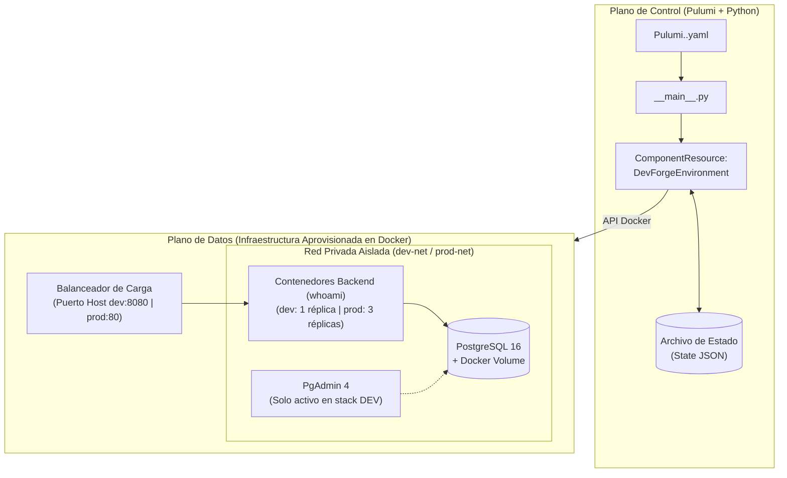
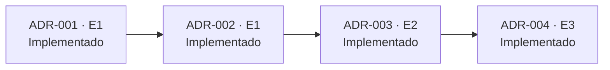

# DevForge Cloud — Contexto Maestro de Arquitectura (SSOT de Diseño)

> **Alcance de este documento:** Este archivo es la fuente de verdad de diseño macro. Se utiliza **exclusivamente** durante sesiones de descubrimiento y redacción de especificaciones (`docs/adrs/ADR-00X.md`).
> **Regla de aislamiento:** Los agentes en rol de *Implementación* o *Revisión* NO leen este documento; se rigen únicamente por `AGENTS.md` y la Parte B del ADR activo. Toda regla de negocio o contrato aquí descrito que aplique a una tarea debe traducirse explícitamente en las secciones 7, 8 y 9 del ADR correspondiente.

---

## 1. Problema y Propósito Arquitectónico
<!-- Alimenta la Sección 1 (Contexto) de la Parte A de los ADRs -->

- **Problema y limitaciones a resolver:** *DevForge v1.0* utilizaba scripts imperativos en PowerShell (`winget`), presentando ausencia de gestión de estado e idempotencia ante fallos parciales, contaminación del sistema anfitrión (*Configuration Drift* por conflictos de puertos y versiones en el SO local) y nula portabilidad hacia entornos de producción o nubes públicas.
- **Solución arquitectónica adoptada:** Evolución hacia Infraestructura como Código (IaC) declarativa con **Pulumi y Python**. Aprovisiona entornos completos, aislados y reproducibles (*Development* y *Production*) mediante una única definición orientada a objetos (`ComponentResource`), garantizando gestión de estado transaccional, detección de desviaciones (*drift*) y autorreparación.
- **Actores / Consumidores:** Desarrolladores de software e ingenieros DevOps que requieren levantar y gestionar entornos estandarizados con un solo comando (`pulumi up`), así como usuarios/clientes HTTP que consumen los servicios expuestos a través del balanceador de carga.

---

## 2. Atributos de Calidad y Restricciones del Proyecto
<!-- Alimenta directamente la Sección 3 (Criterios de elección) de la Parte A de los ADRs -->

### 2.1 Jerarquía de Atributos de Calidad (Trade-offs)
1. **Mantenibilidad y Reutilización (Prioridad Alta):** Encapsulamiento de la topología completa (red, persistencia, cómputo y balanceo) en un único módulo reutilizable (`ComponentResource`), parametrizado por archivos de configuración sin duplicar código entre entornos.
2. **Disponibilidad y Resiliencia (Prioridad Alta):** Capacidad de escalar horizontalmente las réplicas de aplicación detrás de un balanceador de carga en `prod`, sumado a la reconciliación automática del estado deseado (*self-healing*) si un contenedor falla o es eliminado manualmente.
3. **Seguridad por Diseño (Prioridad Media-Alta):** Aislamiento a nivel de red privada (la capa de datos no es accesible desde el exterior) y reducción de superficie de ataque por entorno (PgAdmin se despliega en `dev` pero se omite por configuración en `prod`).
4. **Portabilidad y Costo (Prioridad Media):** Ejecución 100% gratuita y determinista sobre Docker Provider local para el MVP, manteniendo el diseño desacoplado para migrar hacia nube pública (Azure/AWS) en hitos posteriores.

### 2.2 Restricciones Duras (Laboratorio / Entorno / Negocio)
- **Tiempo / Rendimiento objetivo:** Plazo de 24 horas para el Hito 1 (Demo MVP); la implementación debe estar libre de compilaciones pesadas y desplegarse en menos de 15 segundos.
- **Presupuesto y fricción:** Costo $0 USD y cero fricción bancaria (sin uso de tarjetas de crédito ni dependencia de activación de cuentas cloud en el Hito 1).
- **Entorno anfitrión base:** Windows 11 con Docker Desktop y Python 3 (`>=3.10`) instalados.

---

## 3. Arquitectura Macro y Topología del Sistema
<!-- Define los límites espaciales para que los ADRs no rompan el diseño global -->

### 3.1 Stack Tecnológico Base
- **Core / Motor:** Pulumi CLI (grafo DAG, estado transaccional e idempotencia) + Python 3.x (`pulumi`, `pulumi_docker`).
- **Proveedores / Servicios:** Docker Engine (local), Balanceador de Carga (`nginx:alpine` o `traefik`), Backend Dummy (`traefik/whoami`), Capa de Datos (`postgres:16-alpine` con volúmenes Docker) y Gestión DB condicional (`dpage/pgadmin4`).

### 3.2 Diagrama de Topología y Flujo de Interacción

### 3.3 Patrones Arquitectónicos Cloud Adoptados

- **Patrón principal — Deployment Stamps (Sellos de Despliegue).** `DevForgeEnvironment(pulumi.ComponentResource)` empaqueta red privada, persistencia, cómputo y balanceador en una unidad atómica y replicable. El MVP instancia los sellos `dev` y `prod`. E3 propone replicar el sello del sitio primario `prod` en un sitio secundario `dr`.
- **Patrón complementario 1 — External Configuration Store.** `Pulumi.<stack>.yaml` desacopla los parámetros de dimensionamiento y modo de operación del código Python compartido. El cargador valida los valores y construye el contrato inmutable `EnvironmentConfig`.
- **Patrón complementario 2 — Gateway Routing.** El contenedor `nginx:1.27-alpine` actúa como punto de entrada perimetral único para el tráfico de aplicación. El proxy inverso oculta la red bridge privada y distribuye el tráfico entre las réplicas activas. E3 propone extender el enrutamiento para conmutar al sitio secundario en modo *Failover*.

---

## 4. Contratos de Componentes y Reglas de Dominio

### 4.1 Reglas de Negocio / Dominio Inviolables

* **Seguridad condicional de herramientas de gestión:** PgAdmin (`dpage/pgadmin4`) solo se instancia si el flag `enable_pgadmin == True` (activo en `dev`, omitido/bloqueado en `prod`).

* **Aislamiento estricto de persistencia:** El contenedor PostgreSQL (`postgres:16-alpine`) se conecta únicamente a la red privada del stack y nunca expone el puerto `5432` al sistema anfitrión.

* **Prevención de colisiones multi-entorno:** Todo recurso físico y lógico debe incluir el nombre del stack como prefijo (`devforge-{stack}-{recurso}`) y utilizar puertos de host diferenciados por entorno (`dev:8080`, `prod:80`) para permitir la coexistencia simultánea en el mismo daemon de Docker.

* **Pureza declarativa del grafo:** Prohibido ejecutar efectos secundarios imperativos fuera del grafo de Pulumi durante la evaluación ni almacenar credenciales en texto plano en el repositorio.

### 4.2 Componentes Clave y Contratos (Inputs / Outputs)

1. **Configuración por Stack (`Pulumi.dev.yaml` / `Pulumi.prod.yaml`):**
* *Variables / Contrato:* `[replicas, puertos expuestos, límites de recursos, enable_pgadmin, secretos cifrados]`.

2. **Orquestador (`__main__.py`):**
* *Responsabilidad:* Punto de entrada que lee la configuración activa del stack (`pulumi.Config`), instancia el componente de infraestructura y exporta los *Outputs* (`pulumi.export` con metadatos, URLs de acceso y cadenas de conexión).

3. **Abstracción de Infraestructura (`components/environment_stack.py`):**
* *Firma / Clase:* `DevForgeEnvironment(pulumi.ComponentResource)`.

* *Recursos gestionados:* Red virtual puente aislada (`docker.Network`), volumen persistente (`docker.Volume`), contenedor PostgreSQL, instancia condicional de PgAdmin, $N$ réplicas del contenedor de aplicación (`traefik/whoami`) y balanceador de carga conectado a las réplicas.

4. **Backend de Estado (`.pulumi/` local):**
* *Responsabilidad:* Almacena el archivo JSON transaccional con el estado real de la infraestructura para calcular diferencias (`pulumi preview`) y aplicar cambios incrementales (`pulumi up`).

---

## 5. Alcance por Etapas (Control de Scope para Parte B)

- **E1-E2 (MVP Completado).** ADR-001 estableció el proyecto Pulumi con Python y entorno virtual. ADR-002 configuró stacks aislados `dev` y `prod` en Docker local. ADR-003 implementó `DevForgeEnvironment` con persistencia PostgreSQL, PgAdmin condicional, balanceo y reconciliación de recursos. El cierre de E2 se verificó con 25 pruebas en verde.
- **E3 (`Accepted (Implementado)`).** ADR-004 incorpora recuperación ante desastres mediante *Deployment Stamps*. En *Pilot Light*, el sello `dr` mantiene PostgreSQL activo con cero réplicas de aplicación. El plan de *Backup/Restore* proporciona los comandos de respaldo y restauración que ejecuta el operador. La promoción a *Failover* activa tres réplicas y habilita el balanceo de tráfico en `dr`.

---

## 6. Hoja de Ruta y Grafo de ADRs

**Corte de seguimiento del 12-11-2026.** E3 incorpora el sello de contingencia `dr` definido en el [ADR-004](../adrs/ADR-004.md).

| ID | Etapa | Decisión | Estado en la hoja de ruta | Depende de | Alcance y evidencia |
| --- | --- | --- | --- | --- | --- |
| [ADR-001](../adrs/ADR-001.md) | `E1` | Pulumi con Python como motor y lenguaje de IaC | `Accepted (Implementado)` | — | Manifiesto Python con `venv`, dependencias, metadatos y pruebas de bootstrap. |
| [ADR-002](../adrs/ADR-002.md) | `E1` | Docker local y aislamiento mediante Pulumi Stacks | `Accepted (Implementado)` | ADR-001 | YAML de `dev` y `prod`, contrato inmutable `EnvironmentConfig` y redes bridge independientes. |
| [ADR-003](../adrs/ADR-003.md) | `E2` | Modularización con `ComponentResource` y balanceo de carga | `Accepted (Implementado)` | ADR-002 | `DevForgeEnvironment`, PostgreSQL con volumen, PgAdmin condicional, réplicas, Nginx y outputs. |
| [ADR-004](../adrs/ADR-004.md) | `E3` | Recuperación ante desastres con Pilot Light, Backup/Restore y Failover mediante Deployment Stamps | `Accepted (Implementado)` | ADR-003 | `dr` con PostgreSQL activo y 0 réplicas en espera, plan de respaldo y restauración, y promoción a 3 réplicas con un objetivo de RTO inferior a 10 s. |

**Evidencia de E1–E3.** `venv\Scripts\python -m pytest` → `30 passed`, código `0`. `venv\Scripts\python -m compileall -q .` → código `0`. Las 30 pruebas unitarias cubren la configuración y el grafo simulado de `dev`, `prod` y `dr`, incluidos *Pilot Light*, el plan de *Backup/Restore* y la transición a *Failover*. El [guion de demo](../../README.md#guion-paso-a-paso-para-demostración-en-vivo-exposición) permite comprobar con Docker el balanceo HTTP, la reconciliación y la recuperación. El RTO de E3 queda pendiente de medición en vivo.

---

## 7. Registro de Evolución del Contexto Maestro

* **22-10-2026:** Creación de la línea base arquitectónica a partir del Informe Ejecutivo y aprobación de `ADR-001`.
* **22-10-2026:** Actualización de la sección 6 por autorización del Responsable: sincronización de los cuatro ADRs en estado `Accepted`, distinción entre ADR-001 a ADR-003 implementados y ADR-004 pendiente, y grafo de dependencias. Se precisa el alcance de portabilidad previsto por la Parte B de ADR-004.
* **22-10-2026:** Incorporación de la evidencia de 25 pruebas y compilación correcta; registro de los límites de validación operativa, reconciliación y contraseña predeterminada. Se enlaza el README ejecutivo con el guion de demo. Las secciones 1 a 5 se conservan sin modificaciones.
* **12-11-2026:** Cierre de la implementación del MVP (ADR-001 a ADR-003) con 25 pruebas en verde. Se formaliza la adopción de *Deployment Stamps*, *External Configuration Store* y *Gateway Routing*. E3 (ADR-004 en la hoja de ruta) se reorienta a recuperación ante desastres con *Pilot Light* y *Backup*.
* **12-11-2026:** ADR-004 pasa a `Accepted (Implementado)` en la hoja de ruta. La suite de 30 pruebas unitarias en verde cubre `dev`, `prod` y `dr`, incluidos *Pilot Light*, *Backup/Restore* y *Failover*.
